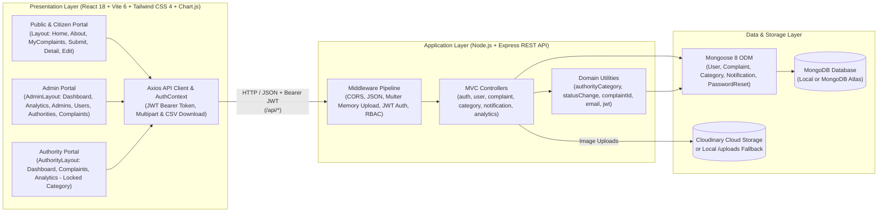
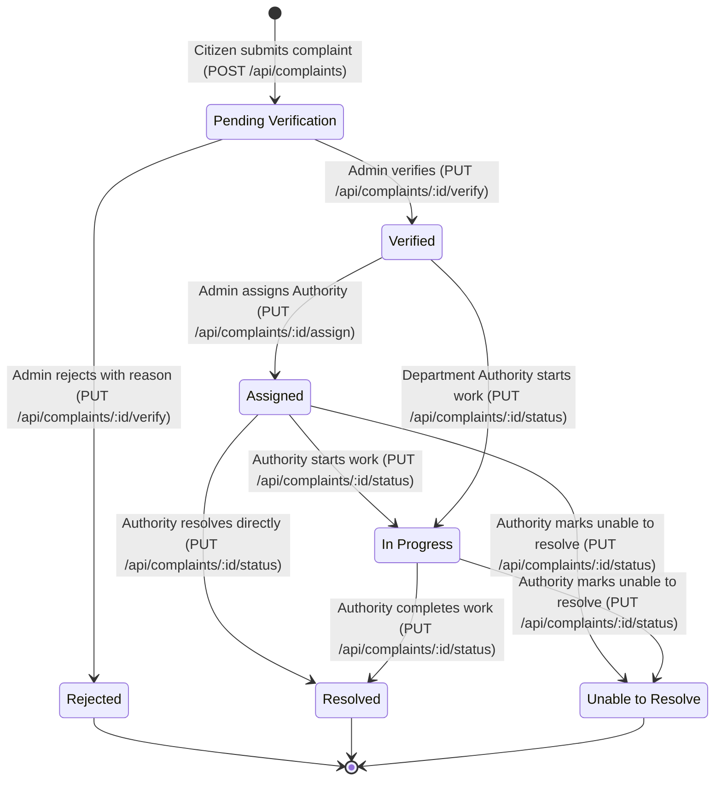
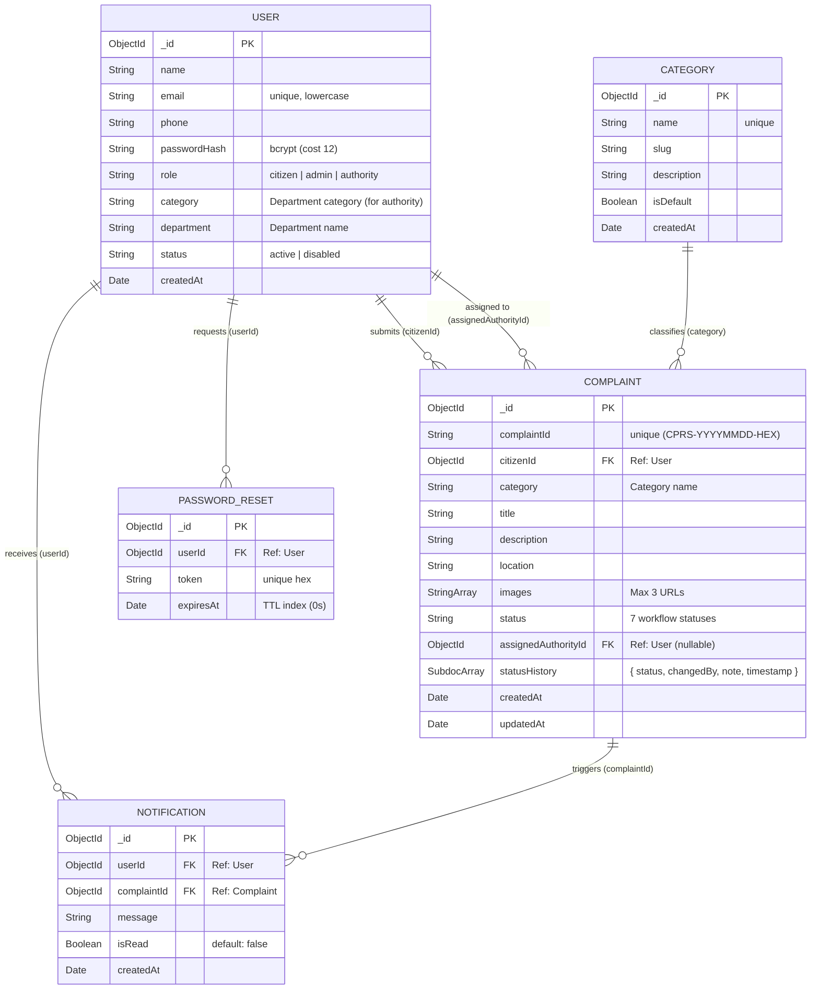

# Community Problem Reporting System (CPRS)
## Full Application Review, System Design (Frontend & Backend), Stakeholder Guide & API Documentation

> **Export Formats Available:**
> - **Microsoft Word `.doc`:** [`CPRS_System_Design_and_Documentation.doc`](CPRS_System_Design_and_Documentation.doc)
> - **Microsoft Word `.docx`:** [`CPRS_System_Design_and_Documentation.docx`](CPRS_System_Design_and_Documentation.docx)
> - **Print / PDF-Ready HTML:** [`CPRS_System_Design_and_Guide.html`](CPRS_System_Design_and_Guide.html)
> - **Markdown:** [`SYSTEM_DESIGN_AND_DOCUMENTATION.md`](SYSTEM_DESIGN_AND_DOCUMENTATION.md)

---

## Table of Contents

1. [Executive Summary](#1-executive-summary)
2. [Role Portals & Automatic Authority Email Pattern](#2-role-portals--automatic-authority-email-pattern)
3. [High-Level System Architecture (3-Tier MERN)](#3-high-level-system-architecture-3-tier-mern)
4. [End-to-End Business Workflow & Complaint Lifecycle](#4-end-to-end-business-workflow--complaint-lifecycle)
5. [Frontend System Design (React 18 + Vite 6 + Tailwind CSS 4 + Chart.js)](#5-frontend-system-design-react-18--vite-6--tailwind-css-4--chartjs)
6. [Backend System Design (Node.js & Express REST API)](#6-backend-system-design-nodejs--express-rest-api)
7. [Complete REST API Reference](#7-complete-rest-api-reference)
8. [Database Design (MongoDB & Mongoose ODM)](#8-database-design-mongodb--mongoose-odm)
9. [Environment, MongoDB & Cloudinary Setup Guide](#9-environment-mongodb--cloudinary-setup-guide)
10. [Developer Onboarding & Monorepo Commands](#10-developer-onboarding--monorepo-commands)

---

## 1. Executive Summary

### What Problem Does CPRS Solve?
Reporting everyday community problems—such as **potholes, overflowing garbage bins, burst water pipes, broken streetlights, blocked storm drains, or park security hazards**—is traditionally slow, fragmented, and opaque. Citizens lack visibility into whether their reports are being addressed, while municipal administrators and department officers lack unified tools to triage reports, route tasks to specialized departments, and measure resolution performance.

### How CPRS Solves It
**CPRS** provides a structured, transparent civic reporting platform across three dedicated role portals:

| Role | Responsibility | Key Capabilities in CPRS |
| :--- | :--- | :--- |
| **1. Citizen (Resident)** | **The Reporter** | Submits complaints with up to 3 photos (`JPG`/`PNG`/`WEBP`, max `5MB` each), receives a unique tracking ID (`CPRS-YYYYMMDD-XXXXXX`), edits/deletes own complaints (with confirmation modal), and tracks live timelines + notifications. |
| **2. Admin (Coordinator)** | **The Traffic Controller** | Operates inside a dedicated `AdminLayout` sidebar portal (`/admin/*`) to view Chart.js analytics, export CSV reports, verify/reject/assign complaints, and manage Admin, Citizen, Authority, and Category records. |
| **3. Authority (Department)** | **The Field Resolver** | Operates inside a dedicated `AuthorityLayout` sidebar portal (`/assigned/*`). Automatically detects the department from the user's email token (`after . and before @`), locks the category filter, updates complaint statuses (`In Progress`, `Resolved`, `Unable to Resolve`), and views department Chart.js analytics. |

---

## 2. Role Portals & Automatic Authority Email Pattern

Every authority user follows the standard email pattern `authority.<token>@cprs.local`. Both the backend (`server/src/utils/authorityCategory.js`) and frontend (`client/src/utils/authorityCategory.js`) inspect the substring **after `.` and before `@`** to automatically resolve the authority's complaint category, filter all complaints and analytics to that category, and disable (`disabled={true}`) the category filter dropdown:

| Role | Department Name | Email | Extracted Token | Auto-Filtered Category | Password |
| :--- | :--- | :--- | :--- | :--- | :--- |
| **Admin** | System Admin | `admin@cprs.local` | — | All Categories | `Admin123!` |
| **Authority** | Roads & Highway Maintenance | `authority.roads@cprs.local` | `roads` | **Road Damage** | `Authority123!` |
| **Authority** | Waste Management & Sanitation | `authority.waste@cprs.local` | `waste` | **Waste Management** | `Authority123!` |
| **Authority** | Water Supply & WASA | `authority.water@cprs.local` | `water` | **Water Leakage** | `Authority123!` |
| **Authority** | Streetlight & Electrical | `authority.lights@cprs.local` | `lights` | **Streetlight** | `Authority123!` |
| **Authority** | Drainage & Stormwater | `authority.drainage@cprs.local` | `drainage` | **Drainage** | `Authority123!` |
| **Authority** | Public Parks & Security | `authority.security@cprs.local` | `security` | **Security** | `Authority123!` |
| **Authority** | General Municipal Works | `authority.general@cprs.local` | `general` | **Other** | `Authority123!` |
| **Citizen** | Rahim Uddin | `citizen1@cprs.local` | — | Own Complaints | `Citizen123!` |
| **Citizen** | Karima Begum | `citizen2@cprs.local` | — | Own Complaints | `Citizen123!` |

---

## 3. High-Level System Architecture (3-Tier MERN)



---

## 4. End-to-End Business Workflow & Complaint Lifecycle



---

## 5. Frontend System Design (React 18 + Vite 6 + Tailwind CSS 4 + Chart.js)

### 5.1 Layout Isolation
- **Standard Public & Citizen Layout (`Layout.jsx`)**: Wraps `/`, `/about`, `/login`, `/register`, `/forgot-password`, `/reset-password`, `/profile`, `/complaints`, `/complaints/new`, `/complaints/:id`, and `/complaints/:id/edit`.
- **Dedicated Admin Layout (`AdminLayout.jsx`)**: Wraps **only** `/admin/*` routes. Features a minimal top header (left logo `/` + right user profile icon), collapsible left sidebar (`Dashboard`, `Analytics & Export`, `Admins`, `Users`, `Authorities`, `Complaints`), icon-only mode on `xs`/`sm` screens, and bottom `Collapse Sidebar` + `Logout` controls.
- **Dedicated Authority Layout (`AuthorityLayout.jsx`)**: Wraps **only** `/assigned/*` and `/authority/*` routes with the same standard header and collapsible sidebar (`Dashboard`, `Complaints`, `Analytics & Export`, bottom `Collapse Sidebar` + `Logout`).

### 5.2 Frontend Route Matrix

| Route Path | Component | Layout | Guard | Description |
| :--- | :--- | :--- | :--- | :--- |
| `/` | `Home` | `Layout` | Public | Landing page with live workflow overview and service categories |
| `/about` | `About` | `Layout` | Public | Mission, architecture, and civic workflow guide |
| `/login` | `Login` | `Layout` | Public | Email & password sign-in with role-based redirect |
| `/register` | `Register` | `Layout` | Public | Citizen self-registration |
| `/forgot-password` | `ForgotPassword` | `Layout` | Public | Request password reset email |
| `/reset-password` | `ResetPassword` | `Layout` | Public | Set new password using reset token |
| `/profile` | `Profile` | `Layout` | `ProtectedRoute` | Edit profile name, phone, avatar, and password |
| `/complaints` | `MyComplaints` | `Layout` | `ProtectedRoute` | Citizen complaint list with filter/search, View, Edit, Delete modal |
| `/complaints/new` | `SubmitComplaint` | `Layout` | `ProtectedRoute` | Multipart complaint submission with up to 3 images |
| `/complaints/:id` | `ComplaintDetail` | `Layout` | `ProtectedRoute` | Full complaint view, evidence gallery, timeline, Edit & Delete modal |
| `/complaints/:id/edit` | `EditComplaint` | `Layout` | `ProtectedRoute` | Edit complaint fields & photos (Category locked for Authority) |
| `/admin` | `AdminDashboard` | `AdminLayout` | `AdminRoute` | Executive KPIs, Chart.js graphs, recent complaints table |
| `/admin/analytics` | `AdminAnalytics` | `AdminLayout` | `AdminRoute` | Full Chart.js Analytics (Line, Bar, Doughnut) & CSV export |
| `/admin/admins` | `AdminAdmins` | `AdminLayout` | `AdminRoute` | Create, edit, and delete administrator accounts |
| `/admin/citizens` | `AdminCitizens` | `AdminLayout` | `AdminRoute` | Search/filter citizens, block/unblock, and delete with confirm modal |
| `/admin/authorities` | `AdminAuthorities` | `AdminLayout` | `AdminRoute` | Manage department authorities and report categories |
| `/admin/complaints` | `AdminComplaints` | `AdminLayout` | `AdminRoute` | Full complaint triage: Verify, Reject, Assign, View, Edit, Delete |
| `/assigned` | `AuthorityDashboard` | `AuthorityLayout` | `AuthorityRoute` | Department KPIs, Chart.js graphs, and recent department complaints |
| `/assigned/complaints` | `AuthorityAssigned` | `AuthorityLayout` | `AuthorityRoute` | Department complaints queue with locked category filter & status modal |
| `/assigned/analytics` | `AuthorityAnalytics` | `AuthorityLayout` | `AuthorityRoute` | Department Chart.js analytics & CSV export with locked category filter |

---

## 6. Backend System Design (Node.js & Express REST API)

- **Authentication (`server/src/middleware/auth.js`)**: Verifies `Authorization: Bearer <token>`, loads the active `User` document, and rejects disabled accounts (`401`).
- **Role-Based Access Control (`server/src/middleware/rbac.js`)**: Enforces `requireRole('admin')`, `requireRole('authority')`, `requireRole('citizen')`, or `requireRole('admin', 'authority')`.
- **Automatic Authority Category Resolution (`server/src/utils/authorityCategory.js`)**: Extracts the token between `.` and `@` in the authority's email (`authority.<token>@...`) and resolves the exact CPRS complaint category for `/api/complaints/assigned`, `/api/analytics/summary`, `/api/analytics/export`, and single-complaint access checks.
- **Image Upload Pipeline (`server/src/config/upload.js` & `cloudinary.js`)**: Validates file count (`<= 3`), file size (`<= 5MB`), and MIME type (`image/jpeg`, `image/png`, `image/webp`). Uploads to Cloudinary when configured or saves to local `server/uploads/` automatically.

---

## 7. Complete REST API Reference

| Method & Endpoint | Access | Request Body / Query Params | Response Summary |
| :--- | :--- | :--- | :--- |
| `GET /api/health` | Public | None | `{ status: "ok", db, database, timestamp }` |
| `POST /api/auth/register` | Public | `{ name, email, phone, password }` | `201 { token, user }` |
| `POST /api/auth/login` | Public | `{ email, password }` | `200 { token, user }` |
| `POST /api/auth/forgot-password` | Public | `{ email }` | `200 { message }` |
| `POST /api/auth/reset-password` | Public | `{ token, password }` | `200 { message }` |
| `GET / POST /api/auth/seed` | Public | None | `200 { message, results, accounts }` |
| `GET /api/users/me` | JWT (Any) | None | `200 { user }` |
| `PUT /api/users/me` | JWT (Any) | `{ name?, phone?, currentPassword?, password? }` | `200 { user }` |
| `GET /api/users` | JWT (`admin`) | `?role=citizen\|authority\|admin&status=&search=` | `200 { users }` |
| `GET /api/users/:id` | JWT (`admin`) | None | `200 { user }` |
| `POST /api/users` | JWT (`admin`) | `{ name, email, phone, password, role, category? }` | `201 { message, user }` |
| `PUT /api/users/:id` | JWT (`admin`) | `{ name?, phone?, category?, password?, role? }` | `200 { message, user }` |
| `PUT /api/users/:id/status` | JWT (`admin`) | `{ status: "active" \| "disabled" }` | `200 { message, user }` |
| `DELETE /api/users/:id` | JWT (`admin`) | None | `200 { message, id }` |
| `GET /api/categories` | Public | None | `200 { categories }` |
| `POST /api/categories` | JWT (`admin`) | `{ name, description? }` | `201 { message, category }` |
| `PUT /api/categories/:id` | JWT (`admin`) | `{ name?, description? }` | `200 { message, category }` |
| `DELETE /api/categories/:id` | JWT (`admin`) | None | `200 { message, id }` |
| `POST /api/complaints` | JWT (`citizen`) | `multipart/form-data`: `category`, `title`, `description`, `location`, `images` (0–3) | `201 { complaint }` |
| `GET /api/complaints/mine` | JWT (`citizen`) | `?status=&category=&search=` | `200 { complaints }` |
| `GET /api/complaints/assigned` | JWT (`authority`) | `?status=&search=` (auto-scoped to authority's category) | `200 { complaints, authorityCategory }` |
| `GET /api/complaints` | JWT (`admin`) | `?status=&category=&authority=&dateFrom=&dateTo=&search=` | `200 { complaints }` |
| `GET /api/complaints/:id` | JWT (Authorized) | None | `200 { complaint }` (includes `statusHistory`) |
| `PUT /api/complaints/:id` | JWT (Authorized) | `multipart/form-data` or JSON: `title`, `category`, `description`, `location`, `images` | `200 { message, complaint }` |
| `DELETE /api/complaints/:id` | JWT (Authorized) | None | `200 { message, id }` |
| `PUT /api/complaints/:id/verify` | JWT (`admin`) | `{ decision: "verified" \| "rejected", reason? }` | `200 { complaint }` |
| `PUT /api/complaints/:id/assign` | JWT (`admin`) | `{ authorityId }` | `200 { complaint }` |
| `PUT /api/complaints/:id/status` | JWT (`authority`) | `{ status: "In Progress" \| "Resolved" \| "Unable to Resolve", note }` | `200 { complaint }` |
| `GET /api/notifications` | JWT (Any) | None | `200 { notifications }` |
| `PUT /api/notifications/:id/read` | JWT (Any) | None | `200 { notification }` |
| `PUT /api/notifications/read-all` | JWT (Any) | None | `200 { message, notifications }` |
| `GET /api/analytics/summary` | JWT (`admin`, `authority`) | `?category=&dateFrom=&dateTo=` | `200 { summary }` |
| `GET /api/analytics/export` | JWT (`admin`, `authority`) | `?category=&dateFrom=&dateTo=` | `200 text/csv` attachment |

---

## 8. Database Design (MongoDB & Mongoose ODM)



---

## 9. Environment, MongoDB & Cloudinary Setup Guide

Configure `server/.env`:
```env
PORT=5000
MONGODB_URI=mongodb://127.0.0.1:27017/cprs
JWT_SECRET=your_production_jwt_secret_here
JWT_EXPIRES_IN=24h
CLIENT_URL=http://localhost:5173

# Optional Cloudinary Configuration (falls back to local /uploads if omitted)
CLOUDINARY_CLOUD_NAME=
CLOUDINARY_API_KEY=
CLOUDINARY_API_SECRET=
```

Configure `client/.env`:
```env
VITE_API_BASE_URL=http://localhost:5000
```

---

## 10. Developer Onboarding & Monorepo Commands

From the project root:
```bash
# 1. Install all server and client dependencies
npm run install:all

# 2. Seed default Admin, 7 Authorities, 2 Citizens, and sample complaints
npm run seed

# 3. Start both Backend (:5000) and Frontend (:5173) concurrently
npm run dev

# 4. Build production frontend bundle
npm run build
```
